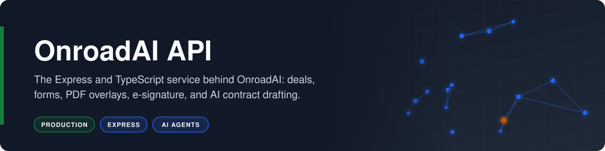
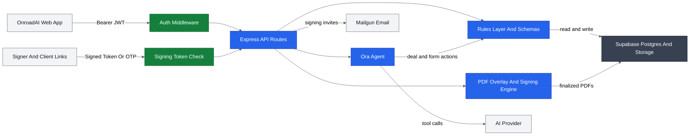

<p align="center"></p>

# OnroadAI API

**The Express and TypeScript service behind OnroadAI: deals, forms, PDF overlays, e-signature, and AI contract drafting.**

    

OnroadAI is a real estate transaction execution platform for realtors, brokers, landlords, and clients, and this repository is its API. It turns one set of client answers into completed, signed, broker-approved Texas real estate forms. OnroadAI helped execute $90K worth of residential lease transactions.

## Overview

The API owns the transaction: deals and properties, the parties on each side, the legal forms each deal requires, the values in those forms, and the signing workflow that finalizes them. It serves the Next.js web client in [risingOnIP/onroad](https://github.com/risingOnIP/onroad), plus token-based portals that let signers and clients act without an account.

- **Canonical data model:** 1,000+ standardized fields across 37 form schemas, so a tenant name or rent amount is captured once and reused on every form.
- **JSON-defined rules layer:** rule sets per transaction side, property type, and state define required and conditional forms, deal stages, and client intake schemas; schema items carry rendering, visibility, and validation rules that the web app uses to render intake forms dynamically.
- **UETA-compliant e-signature:** consent capture, sequenced and delegated signing, a per-event audit trail (timestamp, IP address, user agent, authentication method), and a SHA-256 hash of every finalized PDF.
- **PDF overlays and editor support:** coordinate-based overlays for text, checkmarks, dates, and signatures, plus saved field placements that back the in-browser PDF editor.
- **AI contract drafting:** Ora, an LLM agent with tool calling, turns natural-language requests into deal and form actions and streams results to the browser.
- **Deal management and CRM:** deals with multiple property options, parties tracked from lead through closing, and realtor, client, and broker relationships.
- **Templates and broker portal:** reusable deal templates with prefilled forms, and a broker portal for reviewing and approving agent submissions.

## Business Case

### The Problem

A single Texas residential lease involves several separate legal forms (brokerage disclosure, the lease, a floodplain notice, a pet agreement), and each one asks for the same names, addresses, dates, and amounts. Agents re-key that data by hand, email PDFs back and forth for signatures, and chase their broker for approval in a separate channel. One mistyped deposit amount can invalidate a document, and nothing ties the forms, signatures, and approvals into one record.

### Who It Serves

- **Realtors:** create a deal, collect client intake once, and send a complete, prefilled form packet for signature.
- **Brokers:** review and approve agent submissions, and supply the licensed forms their agents use.
- **Landlords and property owners:** receive a consistent, auditable lease packet for every property.
- **Clients (tenants, buyers, and sellers):** complete intake and sign from a secure link, with no account or software to install.

### The Outcome

- Contract preparation drops from about 10 hours to under 1 hour, because intake answers and the AI agent fill every form in the packet.
- Every signature carries consent, sequence, and device evidence, and every finalized PDF is hashed for tamper detection.
- Brokers approve work in one queue instead of across email threads.
- OnroadAI helped execute $90K worth of residential lease transactions.

## How It Works

Authenticated web requests and token-based signer links enter the API, which resolves forms from the rules layer, renders PDFs, collects signatures, and persists everything to Supabase.



1. **Authenticate:** `src/middleware/auth.ts` verifies Supabase JWTs on realtor and broker routes, while `src/routes/jwt/` serves signer and client portals through signed tokens and email one-time passcodes.
2. **Build the deal:** `src/logic/realtor/deal-logic.ts` creates the deal and attaches the required forms defined in `centralIntelligence/knowledgeBase/` for that transaction type.
3. **Resolve fields:** `src/logic/realtor/form-logic.ts` fills schema fields from cached realtor data, client intake responses, and Supabase lookups, so one answer populates every form that uses it.
4. **Render overlays:** `src/logic/realtor/dealOption-logic.ts` draws text, checkmarks, dates, and signatures at stored coordinates with pdf-lib, and `src/routes/realtor/pdf-actions.ts` stores PDFs produced in the browser editor.
5. **Collect signatures:** `src/logic/realtor/signatures-logic.ts` and `src/routes/jwt/signing.ts` run sequenced and delegated signing and append audit events; `src/logic/jwt/signing-logic.ts` finalizes, hashes, and stores the PDF.
6. **Broker review:** `src/routes/broker/forms-review.ts` moves submissions through `not_sent`, `reviewing`, and `approved`, and `src/routes/broker/broker-forms.ts` applies the field maps in `src/lib/fields/` to broker-supplied forms.
7. **Draft with the agent:** `src/logic/realtor/ai-actions-logic.ts` runs Ora with the tools in `src/logic/realtor/tools/` and streams text, tool progress, and navigation events over Server-Sent Events.

## Tech Stack

| Layer | Technology | Purpose |
|---|---|---|
| Backend | Node.js, Express 4, TypeScript 5 | REST API, routing, and middleware |
| Backend | pdf-lib, pdf-parse, multer | PDF overlays, field placement, finalization, and uploads |
| Data | Supabase (Postgres, Auth, Storage) | Deals, forms, signatures, audit trails, and PDF storage |
| Model | Agents SDK with Zod tool schemas | Ora agent with typed tool calling |
| Network | jsonwebtoken, Supabase email OTP | Signed links for signers and client portals |
| Network | Mailgun | Signing invitations and transaction notifications |
| Tooling | nodemon, ts-node, tsc, cpx | Development server, type checking, and builds |

## Getting Started

### Prerequisites

- Node.js 20 or later and npm.
- A Supabase project with Postgres, Auth, and Storage.
- A Mailgun sending domain.
- An AI provider API key.

### Installation

1. Clone the repository.

   ```bash
   git clone https://github.com/risingOnIP/onroad-express.git
   cd onroad-express
   ```

2. Install the dependencies.

   ```bash
   npm ci
   ```

3. Create the environment file and fill in the values.

   ```bash
   cp .env.example .env
   ```

### Configuration

| Variable | Required | Description |
|---|---|---|
| `PORT` | No | HTTP port, defaults to `3200` |
| `FRONTEND_URL` | Yes | Base URL of the web app, used in email links |
| `SUPABASE_URL` | Yes | Supabase project URL |
| `SUPABASE_ANON_KEY` | Yes | Supabase anon key for user-scoped clients |
| `SUPABASE_SERVICE_ROLE_KEY` | Yes | Supabase service role key for server-side storage and portal access |
| `SUPABASE_JWT_SECRET` | Yes | Secret used to verify Supabase access tokens |
| `SIGNING_JWT_SECRET` | Yes | Secret used to sign and verify signer and client portal links |
| `MAILGUN_API_KEY` | Yes | Mailgun API key |
| `MAILGUN_DOMAIN` | Yes | Mailgun sending domain |
| `OPENAI_API_KEY` | Yes | API key read by the AI provider SDK |
| `AI_MODEL` | No | Model used by the Ora agent, defaults to `gpt-4o-mini` |

### Usage

Start the development server with automatic reload.

```bash
npm run dev
```

Build and run the production server.

```bash
npm run build
npm start
```

The API listens on `http://localhost:3200`, and `GET /health` returns `{"status":"ok"}`. Point the web client's API URL at this address to use the full application.

## Project Structure

```text
onroad-express/
├── src/
│   ├── index.ts                    # Express app and route mounting
│   ├── ai/                         # Agent system prompts and prompt builder
│   ├── config/supabase.ts          # Supabase clients
│   ├── middleware/                 # JWT auth and agent rate limits
│   ├── routes/
│   │   ├── realtor/                # Deals, forms, signatures, templates, agent
│   │   ├── broker/                 # Agent links, form review, uploads
│   │   ├── jwt/                    # Signer and client portal endpoints
│   │   ├── party/                  # Client intake and search
│   │   └── forms/pdf-templates.ts  # Form registry for TREC and TAR
│   ├── logic/
│   │   ├── realtor/                # Deal, form, signing, and agent logic
│   │   │   ├── centralIntelligence/  # Schemas, rule sets, form knowledge
│   │   │   └── tools/              # Agent tool definitions and implementations
│   │   ├── broker/                 # Broker review and blank forms
│   │   └── jwt/                    # Signing finalization and audit trail
│   ├── lib/
│   │   ├── blank_files/            # Bundled TREC PDF forms
│   │   ├── fields/                 # Field maps for broker-supplied forms
│   │   └── mailgun.ts              # Email templates and delivery
│   └── types/                      # Shared TypeScript types
├── docs/assets/banner.svg
├── .env.example
├── package.json
├── tsconfig.json
└── LICENSE
```

## Notes

- Licensed Texas REALTORS forms are not distributed; supply licensed copies to enable those templates.
- The Supabase tables (such as `deals`, `forms`, and `brokerForms`) and storage buckets are provisioned in the Supabase project and are not part of this repository.

## Acknowledgments

Built with Arvin Jakkamreddy, with help from interns on manual form labeling.

## License

Copyright (c) 2025 Karthik Kaligotla and Arvin Jakkamreddy. All rights reserved. The source is published for review; no license is granted. See [LICENSE](LICENSE).

## Author

Developed by [Karthik Kaligotla](https://github.com/risingOnIP), named inventor on U.S. Patents [12,445,488 B2](https://patents.google.com/patent/US12445488B2/) and [12,598,158 B2](https://patents.google.com/patent/US12598158B2/).
